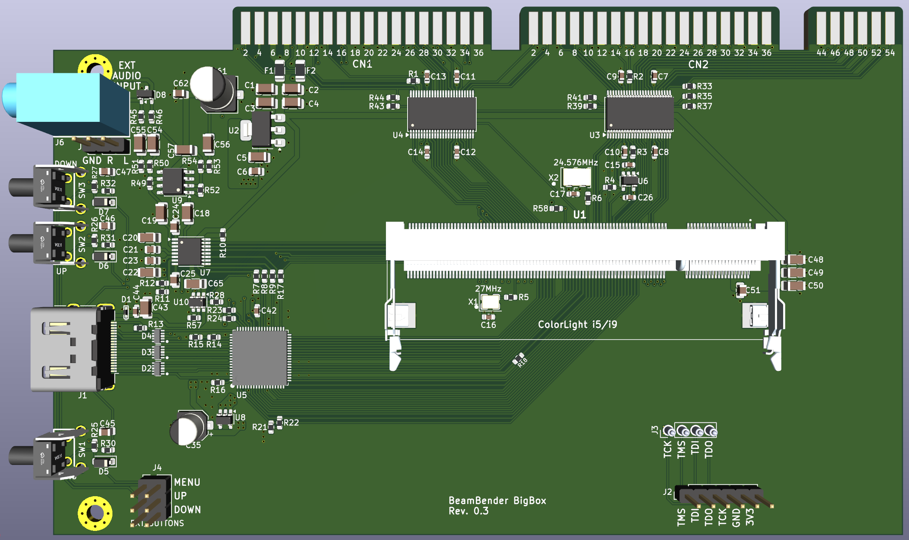
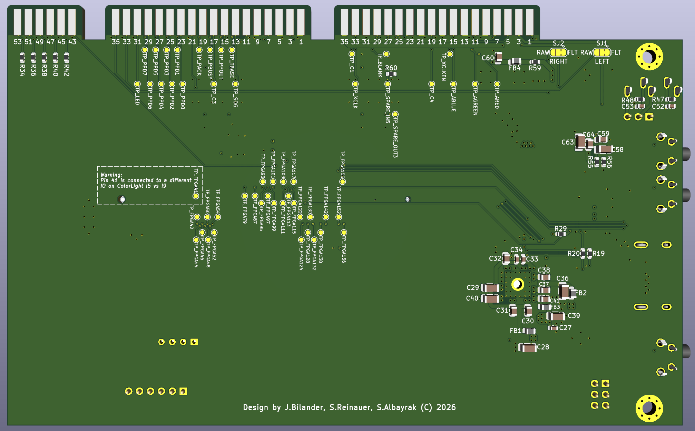
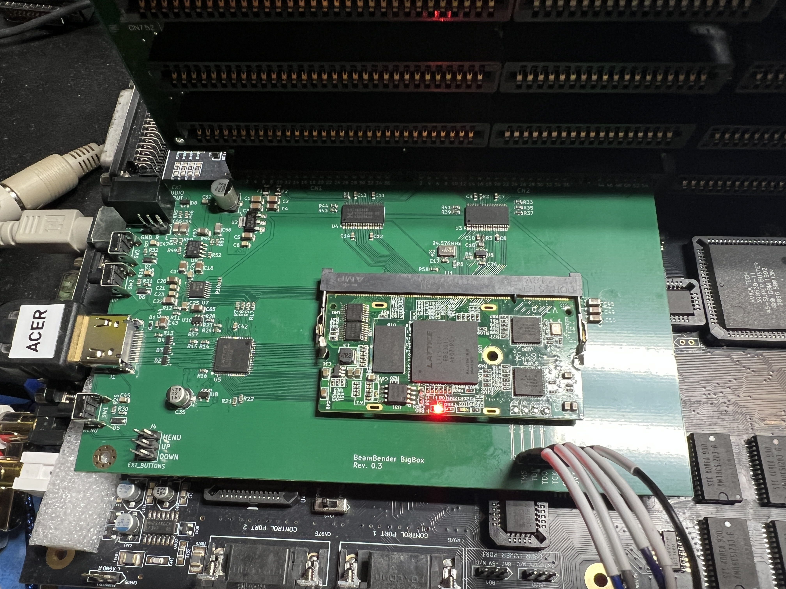
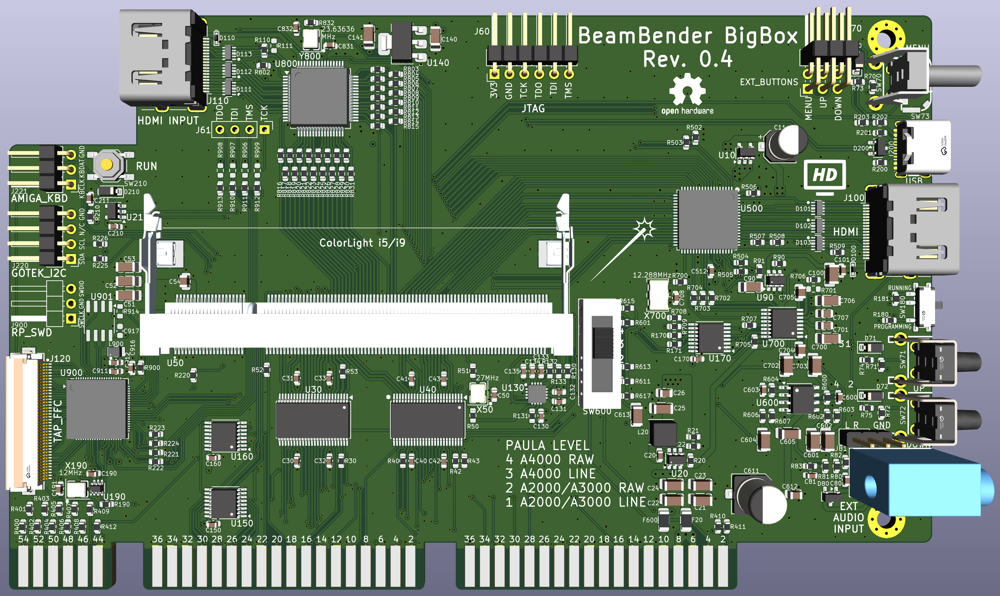
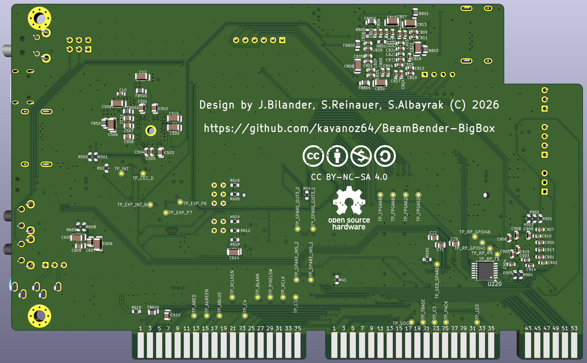

# BeamBender BigBox

A digital scandoubler and HDMI output card for the **Amiga 4000**, with the **Amiga 2000 and 3000** supported as well.

The card plugs into the video slot, taps the digital RGB signals before they ever reach a DAC, and outputs clean **HDMI** with audio. No analog stage, no capture artifacts, no flicker.

> This project is a big-box adaptation of [**jbilander/BeamBender**](https://github.com/jbilander/BeamBender), Jörgen Bilander's scandoubler for the Amiga 1200 (and 500). The original design's approach and much of its analog and HDMI circuitry carry over directly. Jörgen has also provided hardware guidance throughout this redesign. All credit for the concept belongs upstream.

**Status: revision 0.3 works on the Amiga 4000D, 4000T, 3000 and 2000 (OCS, ECS and AGA): every Amiga screen mode including the A2024, DCTV and HAM-E pictures, motion-adaptive deinterlacing, integer and half-step scaling, and fourteen output formats from 640x480 to 1920x1200.** See [Status](#status).

**Using the card:** the [User Guide](USER_GUIDE.md) explains the on-screen menu and the three buttons. Loading the firmware is in [`Firmware/`](Firmware/README.md), the Amiga tools in [`BBLink/`](BBLink/README.md).

---

## What's different from the A1200 original

The A1200 version clips onto the Lisa chip and connects to the main board with an FFC cable. Big-box Amigas have the same signals on the video slot, so this version is a **single PCB with no cables**, taking digital RGB, syncs, the pixel clock, audio and power straight off the slot.

| | A1200 BeamBender | BeamBender BigBox |
|---|---|---|
| Signal source | Lisa chip (PLCC-84 clip) | Video slot |
| Boards | Two, joined by FFC | One |
| FPGA | Gowin GW1NR-9 (on-board) | Colorlight i5 or i9 module (SO-DIMM socket) |
| Video RAM | FPGA-internal | 8 MB 32-bit SDRAM on module |
| Audio in | 3.5 mm jack | Video slot, plus aux header and jack, mixed |
| Power | External connector | Slot |

---

## Hardware

**FPGA:** a [Colorlight i5 v7.0](https://github.com/wuxx/Colorlight-FPGA-Projects) module in a 200-pin DDR2 SO-DIMM socket (TE 1473149-4), with a Lattice **ECP5 LFE5U-25F** (24k LUT), **8 MB of 32-bit SDRAM** for the frame buffer, and its own configuration flash and regulators. The ECP5 only comes in BGA, so the module is deliberate: a dead one is a socket swap, not a rework job. **SO-DIMM pin 41**, the one ball that differs between the i5 and the i9, is left unconnected so the two are interchangeable.

**The i9 (LFE5U-45F, 44k LUT, 4 PLLs) is the recommended module** for the Rev 0.3 board. It drops into the same socket, and on a board without the clock generator below its two extra PLLs clock the seven formats that need 40, 65, 108 or 162 MHz. It is also the module with room for what comes next. Build with an i9 unless cost decides.

The **i5 (LFE5U-25F)** is the cheaper option, with its own bitstream. On its own it runs the other seven formats (640x480, 720x576 / 720x480, 1280x720, 1280x800, 1680x1050, 1920x1080 and 1920x1200), enough for most televisions and monitors; with the **Si5351C** fitted it runs all fourteen. It will be the recommended module for the Rev 0.4 and later boards.

**Clock generator:** an **Si5351C** makes the pixel clocks the ECP5's PLLs cannot make from 27 MHz: 162 MHz for 1600x1200, 108 for 1280x960, 1280x1024, 1440x900 and 1600x900, 65 for 1024x768 and 40 for 800x600. It is a rework on revision 0.3 and part of the next revision. One firmware per module serves boards with and without it: the card measures its clocks at power-up and offers only the formats it can make.

**Video out:** an **SiI9022A** HDMI transmitter, fed 24-bit RGB at up to 162 MHz. An ECP5 without SERDES cannot generate HDMI's TMDS signals itself fast enough for 1080p60.

**Audio:** an **AK5720** 24-bit ADC sends I²S straight to the SiI9022A. Ahead of it, an **OPA1692** summing amplifier mixes the Amiga's audio from the slot with an auxiliary input, on an internal header or a 3.5 mm jack (a plug in the jack disconnects the header), so another card's audio or an external source can be folded in.

**HDMI +5V:** a **TPS2553** load switch feeds HDMI pin 18, current-limited and blocking reverse current, so neither a shorted cable nor a television pushing 5V back can reach the Amiga's supply. The on-screen display reports its fault line.

**Level shifting:** two 74LVC16244 buffers translate the Amiga's 5V logic to 3.3V; the ECP5 is *not* 5V tolerant.

**Board:** 157.5 x 90 mm, 4-layer, with dedicated ground and 3V3 planes.

### Where to buy the module

[Colorlight i5 + ext-board bundle on AliExpress](https://www.aliexpress.us/item/3256807602160285.html)

Buy the **module and the dev board together**. The card programs the module in place through its JTAG header, but the dev board is a second, independent way to load or recover a bitstream.

---

## Clock architecture

| Clock | Source | ECP5 pin | PLL |
|---|---|---|---|
| **C28O**, 28.375 MHz PAL / 28.636 NTSC | Alice, via slot | 91 · `PCLKT2_1` | none, already the pixel clock |
| **VCDAC x2**, 14.19 MHz | Agnus/Alice CDAC, doubled on-board | 81 · `PCLKT3_1` | x2 to 28.375 MHz |
| **27 MHz** | on-board oscillator | 134 · `PCLKT7_1` | x5.5 to 148.5 MHz output |
| **24.576 MHz** | on-board oscillator | 89 · `PCLKT2_0` | none, audio MCLK reference |

**27 MHz** because 148.5 MHz, the pixel clock of 1080p at both 50 and 60 Hz, is exactly 27 x 5.5. The module's own 25 MHz cannot make it.

**The A2000 and A3000 have no 28 MHz clock on their video slots.** Their fastest, VCDAC at 7.09/7.16 MHz, is below the PLL's 8 MHz minimum, so an XOR gate and an RC delay double it on the board and the PLL takes it from there. The A4000 runs from C28O; the card detects which clock is present and picks it by itself.

---

## Amiga 2000 / 3000 support

The pre-AGA video slot carries **12-bit color** (RGB444), and each 4-bit value is widened to 8 bits exactly (0 to 0, 15 to 255). The card tells the machines apart by itself, from the AGA slot's extra pins, which only the A4000 has.

The A3000 and the A2000, with OCS and with ECS chips, are confirmed working.

---

## Programming

The module's JTAG pads are not on the SO-DIMM edge, so four **spring-loaded pogo pins** reach them from below, wired to a **1x6 JTAG header** on the card. An FT232H or FT2232H adapter and `openFPGALoader` write the firmware to the module's flash, from which the card boots on its own ([how](Firmware/README.md)).

---

## Firmware

The gateware captures the Amiga's digital RGB into the module's SDRAM, scales it and drives the SiI9022A.

**Prebuilt bitstreams are in [`Firmware/`](Firmware)**, two per module: the standard firmware and the `-c28` build, which locks 1920x1080 at 50 Hz to the Amiga's PAL frame ([which to load](Firmware/README.md#standard-or--c28)). The AmigaOS tools that drive the card are in [`BBLink/`](BBLink). The firmware **sources are not published yet**; they will be once the gateware is mature enough to hand to others.

**Output formats**, chosen from the menu:

| | i9 (recommended) | i5 | i5 with Si5351C |
|---|---|---|---|
| 640x480 | yes | yes | yes |
| 720x576 / 720x480 | yes | yes | yes |
| 800x600 | yes | no | yes |
| 1024x768 | yes | no | yes |
| 1280x720 | yes | yes | yes |
| 1280x800 | yes | yes | yes |
| 1280x960 | yes | no | yes |
| 1280x1024 | yes | no | yes |
| 1440x900 | yes | no | yes |
| 1600x900 | yes | no | yes |
| 1600x1200 | yes | no | yes |
| 1680x1050 | yes | yes | yes |
| 1920x1080 | yes | yes | yes |
| 1920x1200 | yes | yes | yes |

All of them run at 50 or 60 Hz, following the Amiga or forced from the menu. The 1280x800, 1440x900, 1600x900 and 1680x1050 formats drive panels of those sizes at their native resolution.

**Scaling.** The horizontal and vertical scales are set separately. **Auto** picks the largest whole scale that fits and centers the picture: PAL on 1080p is x2 by x3. Forced scales add **blended half steps**, x1.5 to x5.5, where the middle row or column of each pair is the average of the two, so the 288 lines of PAL overscan fill 1008 of 1080p's rows at x3.5 with no uneven scanlines. Super-Hires is drawn on its own 1280 samples, and LoRes screens are stored one sample per pixel, so a 320-pixel screen reaches x6. The menu counts in the screen's own pixels: a laced PAL screen is 640x512, a Super-Hires one 1280 wide.

**Overscan Auto** captures more of the Amiga's picture around the window you set, as much as fits at the scale in force, so a game or demo that draws into the overscan area is shown whole.

**Picture effects:** scanlines (Light, Medium, Deep), **Pixel Smoothing** (Soft, Softer, Softest: a sharp bilinear that takes the blockiness out of a scaled picture on a flat panel), and **Gamma**, 0.42 to 2.38 in eleven steps, which leaves black, white and the menu as they are.

**Input.** Every mode the Amiga's monitor drivers produce: PAL and NTSC, Euro36, Euro72, Super72, DblPAL, DblNTSC and Multiscan, in LoRes, HiRes and Super-Hires, progressive and interlaced. The card recognizes the mode by itself and keeps a settings set for each (separately for ECS and AGA), so the position and sampling phase you set for a mode come back with it. Interlaced screens are **deinterlaced motion-adaptively** on both modules: still parts are woven at full sharpness and only what moves is interpolated, so a still Workbench stays sharp and a moving pointer or window does not comb. Weave and Bob are there too, and Super-Hires interlace is woven.

**Custom monitors and the BB- drivers.** A monitor driver with timing of its own is taken as CUSTOM15 or CUSTOM24, by its line rate, with a settings set each. Four AmigaOS 3 monitor drivers of the card's own, in [`BBLink/Monitors`](BBLink/Monitors/README.md), make interlaced screens with the Amiga's own chipset, which the card weaves and shows 1:1 on the output format of the same size: a 1024x768 Workbench on a 1024x768 monitor, with no graphics card.

| Driver | Resolution | Colors on OCS | Colors on ECS | Colors on AGA |
|---|---|---|---|---|
| BB-800x600 | 800x600 | not supported | 16 (High Res) | 256 |
| BB-1024x768 | 1024x768 | not supported | 4 | 256 |
| BB-1280x1024 | 1280x1024 | not supported | 4 | 256 |
| BB-HD720p | 1280x720 | not supported | 4 | 256 |

They need AmigaOS 3.0 or later, and AGA or both ECS chips (an ECS Agnus and the ECS Denise). On ECS they have so far run in an emulator only.

**The A2024**, 15 Hz and 10 Hz, PAL and NTSC: the card reassembles the monitor's panels in its frame buffer, as the A2024 itself did, and shows the whole 1024x1024 (PAL) or 1024x800 (NTSC) grayscale picture 1:1 on 1280x1024 or 1080p. BeamBender BigBox is the first Amiga scandoubler to display the A2024 modes.

**DCTV and HAM-E.** The card decodes Digital Creations' **DCTV** and Black Belt Systems' **HAM-E** pictures itself, with neither box fitted, by reading the same digital lines the boxes read on the 23-pin video port. A picture is recognized by its DCTV signature or HAM-E cookie, so there is nothing to switch on; HAM-E works in both its register and HAM modes. The screen's first line has to be in the capture window or just above it (for HAM-E also its left edge), and DCTV widens the window by itself. Not on Super-Hires screens or A2024 monitors.

**On-screen display.** A text menu on the card's three buttons sets all of the above, with Display Info, Monitor Info, Monitor Modes and Si5351 Info pages. Settings are saved to the module's flash. Firmware from 2026-10-28.05 on does not read settings saved by older firmware, so back them up with BBLink before updating from one.

**Monitor Info** shows who the monitor is, from its EDID; **Monitor Modes** lists every output format and whether the monitor claims it at 50 and 60 Hz (one marked No may still work).

**Hot plug.** Replug the HDMI cable or swap the monitor, and the picture comes back on its own within about a second.

**Sampling calibration** finds the best capture phase against a still picture in about six seconds.

**The Amiga control link** is three wires between test points already on the card, a full-duplex link to AmigaOS. The tools in [`BBLink/`](BBLink) use it: `BBLink` (1.30) has every setting, the live pages and the card's buttons in a window, and backs the settings up to a text file and restores them; `BBMode` tells the card which monitor the Amiga switched to; `BBKeyCon` puts the card's buttons on the keyboard; `BBSurvey`, `BBProbe`, `BBScreen` and `BBLag` measure and diagnose. The wiring is in that README.

**Latency**, measured with BBLag and a 240 fps camera: the HDMI picture is one to two fields (20 to 40 ms) behind an analog monitor's, the HDMI monitor's own processing included. One field of it is the frame buffer, by design.

---

## Status

**The revision 0.3 board works**, on an **Amiga 4000D**, an **Amiga 4000T**, an **Amiga 3000** and an **Amiga 2000**.

Confirmed on hardware:

- [x] HDMI output with audio, on several monitors
- [x] A4000D and A4000T (C28O), A3000 and A2000 (doubled VCDAC), OCS, ECS and AGA
- [x] Every screen mode: PAL, NTSC, DblPAL, DblNTSC, Super72, Euro36, Euro72 and Multiscan, Super-Hires at full width, interlace
- [x] The A2024, 15 Hz and 10 Hz, PAL and NTSC, as the full 1024-line picture
- [x] DCTV and HAM-E pictures, on both modules
- [x] Motion-adaptive deinterlacing, on both modules
- [x] Fourteen output formats, 640x480 to 1920x1200, at 50 and 60 Hz; all of them on the i5 with the Si5351C
- [x] Integer and blended half-step scaling, Overscan Auto, Pixel Smoothing, Gamma
- [x] The BB- monitor drivers, woven and shown 1:1
- [x] The on-screen menu, settings in flash, sampling calibration
- [x] Monitor Info and Monitor Modes from the monitor's EDID (i9), hot plug
- [x] The Amiga control link and the BBLink tools
- [x] Latency: one to two fields to the HDMI monitor

Still open:

- [ ] Measure actual current on the 5V and 3.3V rails

### Next steps

**Hardware: revision 0.4**, in layout now:

- **An HDMI input for an RTG (ReTargetable Graphics) card** such as the Z3660, through an ADV7611 receiver: one monitor cable for the Amiga's screens and RTG, with the RTG card's audio. The menu, the status lines and Gamma work on the RTG picture too, with Gamma set for each source.
- **Automatic switching between the Amiga and RTG**, told by Aminet's `switchcontrol` over the parallel port, with the sound following the picture. The Amiga capture keeps running behind RTG, so switching back is instant.
- **The Si5351C on the board**, so every output format runs on both modules with no rework.
- **The Amiga control link on the board**, through the parallel port: no wires, and a byte per clock edge instead of a bit.
- **An RP2354B microcontroller** that runs the on-screen menu and everything shown over the picture, leaving room on the i5 for the RTG input. It also reads the Amiga keyboard, so the menu works from the keyboard, even in a game that boots from floppy.
- **The Gotek's FlashFloppy display on screen**, over either picture, so no display has to be fitted to the case.
- **USB-C on the back plate** for firmware updates from a PC, with no JTAG programmer. The card never draws power from USB.
- **A connector for optional Lisa and Denise tap boards** on the A4000 (Jörgen's [LISA_to_FPGA](https://github.com/jbilander/Lisa_to_FPGA)), on the A2000 and A3000 ([Denise_to_FPGA](https://github.com/jbilander/Denise_to_FPGA)) which pass Lisa and Denise's register writes to the FPGA.
- **The Amiga audio input chosen by a slide switch**: line or raw audio, for the A4000 or for the A2000 and A3000. No soldering, as for every user setting.
- Smaller changes: the audio master clock from its own oscillator, a 3A switching regulator for 3.3V, and right-angle JTAG and button headers.

**Firmware.** Publishing the sources.

---

## Building one

The revision 0.3 manufacturing files are in [`jlcpcb/`](jlcpcb), for **JLCPCB** fabrication and assembly. [`jlcpcb/production_files`](jlcpcb/production_files) holds the three files to upload there: the zipped Gerbers and drill files, the bill of materials with LCSC part numbers, and the pick-and-place file; [`jlcpcb/gerber`](jlcpcb/gerber) has the Gerbers unzipped. The Colorlight module and the pogo pins are fitted by hand afterwards. On this revision the Si5351C is a rework (without it the card offers the formats [above](#firmware) for its module), and the Amiga control link is three wires ([BBLink](BBLink/README.md)).

Fit an **i9** unless cost rules it out. A finished board needs no toolchain: load the matching bitstream from [`Firmware/`](Firmware).

---

## Credits

- **[Jörgen Bilander](https://github.com/jbilander)**, original BeamBender design, and ongoing guidance on this adaptation
- **[Salih Albayrak (aka Kavanoz)](https://github.com/kavanoz64)**, hardware design and implementation for BigBox
- **[Stefan Reinauer](https://github.com/reinauer)**, FPGA programming
- **Claude AI** (Anthropic), design review, component selection, gateware and documentation
- **[wuxx](https://github.com/wuxx/Colorlight-FPGA-Projects)** and the Colorlight reverse-engineering community, for module pinouts and documentation that the vendor doesn't publish

## License

Please check the licensing of the upstream [BeamBender](https://github.com/jbilander/BeamBender) project before redistributing derived work.
